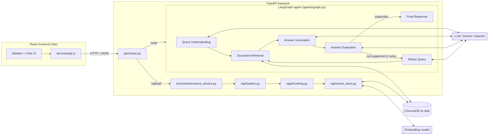

# DataOps AI Assistant – Agentic RAG Application

Upload technical documentation (dbt, Snowflake, SQL, pipeline runbooks) and ask questions about it.
The assistant retrieves the relevant passages with **RAG**, answers through a **LangGraph agent**,
checks its own answer against the sources, and shows exactly which documents it used. If the
documents don't contain the answer, it says so instead of guessing.

 
 


---

## Features

- **Document upload** – PDF, TXT, Markdown and SQL files.
- **Ingestion pipeline** – text extraction → chunking → embeddings → ChromaDB.
- **RAG retrieval** – semantic search, optionally limited to selected documents.
- **LangGraph agent** – Query Understanding → Retrieval → Generation → Evaluation → Final Response,
  with **one automatic retry** (improved query + more context) when the answer isn't supported.
- **Answer evaluation** – LLM-as-a-judge checks relevance and groundedness for every answer.
- **Source references** – document name, page (PDF), chunk and match score, with numbered citations.
- **Honest "I don't know"** – a clear message when the documents lack the information.
- **Offline evaluation suite** – test dataset + report (retrieval hit rate, groundedness, etc.).
- **React dashboard** – sidebar with documents, chat, loading indicator, clear chat, responsive layout.
- **Configurable LLM provider** – Google Gemini (free tier) by default, OpenAI optional.

## Architecture



**Request flow for a question**

1. React sends `POST /chat {"question": "..."}`.
2. *Query Understanding* – the LLM classifies intent (question vs. summary) and writes a better search query.
3. *Document Retrieval* – the query is embedded and ChromaDB returns the top-k most similar chunks
   (for summaries: the opening chunks of each document).
4. *Answer Generation* – the LLM answers **only** from those chunks and cites them as `[1]`, `[2]`.
5. *Answer Evaluation* – a second LLM call (the "judge") checks relevance and groundedness.
6. Not supported? → *Refine Query* rewrites the search query, retrieval runs again with more chunks,
   and the prompt is made stricter. Still not supported → the user is told the documents don't contain enough information.
7. *Final Response* – answer + sources + evaluation are returned to React.

## Technology stack

| Layer | Technology |
|---|---|
| Backend | Python, FastAPI, Uvicorn, Pydantic |
| AI / RAG | LangChain (loaders, splitters, model wrappers), LangGraph (agent workflow) |
| LLM & embeddings | Google Gemini (`gemini-2.5-flash`, `gemini-embedding-001`) or OpenAI – configurable |
| Vector database | ChromaDB (local, persistent) |
| Frontend | React 18, Vite, plain CSS |
| Testing | pytest with fake LLM/embeddings (no API calls, no cost) |
| Evaluation | Custom metrics + LLM-as-a-judge, Markdown/JSON report |

## Project structure

```
dataops-ai-assistant/
├── backend/
│   ├── app/
│   │   ├── main.py                 # FastAPI app, CORS, router
│   │   ├── config.py               # settings from .env
│   │   ├── api/                    # routes.py (endpoints), schemas.py (request/response models)
│   │   ├── services/               # llm_provider.py, document_service.py, document_registry.py
│   │   ├── rag/                    # loaders.py, chunking.py, vector_store.py, retriever.py
│   │   ├── agents/                 # state.py, prompts.py, nodes.py, graph.py
│   │   └── evaluation/             # dataset.json, metrics.py, run_evaluation.py
│   ├── scripts/check_llm.py        # quick API-key / model check
│   ├── tests/                      # pytest suite
│   ├── pytest.ini
│   └── requirements.txt
├── frontend/
│   ├── src/
│   │   ├── components/             # Sidebar, DocumentList, UploadButton, ChatWindow, MessageBubble, ...
│   │   ├── pages/ChatPage.jsx      # page state + layout
│   │   ├── services/api.js         # all calls to the backend
│   │   ├── App.jsx, main.jsx, styles.css
│   └── package.json
├── sample_documents/               # demo dbt / Snowflake / pipeline / SQL / PDF docs
├── docs/                           # concepts guide, interview guide, screenshots
├── .env.example
├── .gitignore
├── LICENSE
└── README.md
```

## Installation

### Prerequisites

- Python **3.11 or 3.12**
- Node.js **20 or 22 LTS**
- Git
- A free Google Gemini API key from <https://aistudio.google.com/apikey> (or an OpenAI key)

### 1. Clone

```bash
git clone https://github.com/<your-username>/dataops-ai-assistant.git
cd dataops-ai-assistant
```

### 2. Configure environment

```bash
# Windows (cmd)
copy .env.example .env
# macOS / Linux
cp .env.example .env
```

Edit `.env` and set `GOOGLE_API_KEY=...`. **Never commit `.env`** – it is listed in `.gitignore`.

| Variable | Default | Meaning |
|---|---|---|
| `LLM_PROVIDER` | `gemini` | `gemini` or `openai` |
| `GOOGLE_API_KEY` | – | Gemini key |
| `GEMINI_CHAT_MODEL` | `gemini-2.5-flash` | Chat model name |
| `GEMINI_EMBEDDING_MODEL` | `models/gemini-embedding-001` | Embedding model |
| `OPENAI_API_KEY` / `OPENAI_CHAT_MODEL` / `OPENAI_EMBEDDING_MODEL` | – | Used when `LLM_PROVIDER=openai` |
| `CHUNK_SIZE` / `CHUNK_OVERLAP` | `1000` / `150` | Characters per chunk / overlap |
| `TOP_K` | `4` | Chunks retrieved per question |
| `DATA_DIR` | `./data` | Uploads, ChromaDB and registry (relative to `backend/`) |
| `FRONTEND_ORIGIN` | `http://localhost:5173` | Allowed CORS origin |

> Changing the embedding model or provider after uploading documents makes the stored vectors
> incompatible – delete `backend/data/` and upload the documents again.

### 3. Backend

```bash
cd backend
python -m venv .venv
# Windows (cmd):        .venv\Scripts\activate.bat
# Windows (PowerShell): .\.venv\Scripts\Activate.ps1
# macOS / Linux:        source .venv/bin/activate
pip install -r requirements.txt
python -m scripts.check_llm          # optional: verifies key + models
uvicorn app.main:app --reload --port 8000
```

API docs: <http://localhost:8000/docs>

### 4. Frontend (second terminal)

```bash
cd frontend
npm install
npm run dev
```

Open <http://localhost:5173>, upload files from `sample_documents/`, and start asking.

## API documentation

| Method | Endpoint | Description |
|---|---|---|
| `GET` | `/health` | Backend status, provider, models, whether the API key is set, document count |
| `POST` | `/upload` | Upload one file (`multipart/form-data`, field `file`). Returns the document record |
| `GET` | `/documents` | List uploaded documents |
| `DELETE` | `/documents/{document_id}` | Delete a document, its file and all its chunks |
| `POST` | `/chat` | Ask a question |

**`POST /chat` request**

```json
{ "question": "What is a DBT incremental model?", "document_ids": null }
```

**Response (shortened)**

```json
{
  "answer": "An incremental model only processes new or changed rows after the first run [1]...",
  "sources": [
    { "ref": 1, "document_name": "dbt_incremental_models.md", "page": null, "chunk_index": 0,
      "relevance_score": 0.82, "snippet": "An incremental model is a dbt model that..." }
  ],
  "insufficient_information": false,
  "attempts": 1,
  "search_query": "dbt incremental model materialization new changed rows",
  "evaluation": { "retrieval_relevance": 0.79, "answer_relevant": true, "grounded": true,
                  "groundedness_score": 0.95, "passed": true, "reason": "All claims appear in context [1]." }
}
```

Errors return `{"detail": "..."}` with status `400` (bad file / input), `404` (unknown document),
`422` (validation) or `502` (AI provider error, e.g. rate limit).

## Example questions

- What is a DBT incremental model?
- What does the `is_incremental()` macro do?
- Explain Snowflake Streams and Tasks.
- Why is my newly created Snowflake task not running?
- How can I troubleshoot a failed data pipeline?
- What is the purpose of a staging layer?
- What source freshness thresholds should daily sources use? *(answer is in the PDF)*
- Summarize the uploaded document. *(tick one document in the sidebar first)*
- How do I configure Kubernetes autoscaling? *(not in the docs → "not enough information")*

## Testing

Unit and integration tests use a **fake LLM and fake embeddings**, so they are fast, free and
need no API key.

```bash
cd backend
pytest -v
```

Covered: health check, file loading and chunk metadata, upload/list/delete, retrieval and
document filters, the agent's happy path, retry → "insufficient information" path,
rejection of ungrounded answers, summary intent, evaluation metrics and report generation.

## LLM evaluation

```bash
cd backend
python -m app.evaluation.run_evaluation            # add --delay 5 if you hit free-tier rate limits
```

This uses a separate store (`backend/data/eval`), ingests `sample_documents/`, runs the 11
questions in `app/evaluation/dataset.json` (9 answerable, 2 deliberately unanswerable) through the
real agent, and writes `app/evaluation/reports/eval_report.md` and `.json`.

| Metric | What it measures | How |
|---|---|---|
| Retrieval hit rate | Was the expected document retrieved? | Exact file-name match |
| Retrieval relevance | How similar retrieved chunks are to the question | Mean vector-similarity score |
| Answer relevance | Does the answer address the question? | LLM judge |
| Groundedness | Is the answer supported by the retrieved context? | LLM judge (bool + 0–1 score) |
| Keyword coverage | Does the answer mention key facts? | Expected keywords present |
| Semantic similarity | Closeness to a reference answer | Embedding cosine similarity |
| Insufficient-info handling | Does it refuse when it should? | Unanswerable questions must be flagged |

**Limitations – please read.** These checks are useful signals for catching regressions, **not
proof of factual correctness**. Keyword checks can pass a wrong answer and fail a correct
paraphrase; embedding similarity measures topic, not truth; the LLM judge can be wrong or lenient
(especially when judging its own model's output); and 11 questions is a smoke test, not a
benchmark. Results also vary between runs. Human review of sample answers is still essential.

## Screenshots

Add your own screenshots to `docs/screenshots/` and reference them here:

```markdown


```

## Publishing to GitHub

1. Create an **empty** repository on GitHub named `dataops-ai-assistant` (no README, no .gitignore).
2. In the project root:

```bash
git init
git branch -M main
git status                 # make sure .env is NOT listed
git add .
git commit -m "Initial commit: DataOps AI Assistant (Agentic RAG)"
git remote add origin https://github.com/<your-username>/dataops-ai-assistant.git
git push -u origin main
```

3. If GitHub asks for a password, use a **Personal Access Token** (GitHub → Settings → Developer settings → Tokens).
4. If you ever commit a key by mistake: revoke/rotate the key immediately – deleting the file is not enough, it stays in Git history.

## Future enhancements

- Streaming answers token-by-token (Server-Sent Events).
- Conversation memory for follow-up questions.
- Hybrid search (BM25 keyword + vectors) and a re-ranker.
- More loaders (DOCX, HTML, Confluence, GitHub repos of dbt projects).
- Local models via Ollama for fully offline use.
- Tracing/observability with LangSmith or OpenTelemetry.
- Larger evaluation set and RAGAS-style metrics; CI that runs tests on every push.
- Docker Compose for one-command startup; user authentication.

## Learn more

- [`docs/concepts.md`](docs/concepts.md) – beginner explanations of LLMs, RAG, embeddings, LangGraph… using this project as the example.
- [`docs/interview_guide.md`](docs/interview_guide.md) – how to present and defend this project in an interview.

## License

MIT – see [LICENSE](LICENSE).
